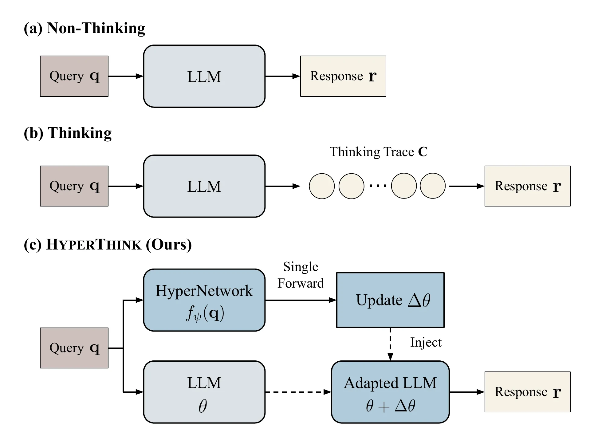

<h1 align="center">HyperThink: Text-to-Parameter Hypernetworks for Efficient Reasoning</h1>

<p align="center">
  <a href="https://gitgyun.github.io/">Donggyun Kim</a><sup>1*</sup>,
  <a href="https://jacklu-me.com">Jack Lu</a><sup>2*</sup>,
  <a href="https://cwhoaon.github.io">Chanwoo Kim</a><sup>1</sup>,
  <a href="https://mengyeren.com/">Mengye Ren</a><sup>2</sup>,
  <a href="https://maga33.github.io/">Seunghoon Hong</a><sup>1</sup>
  <br>
  <sup>1</sup>KAIST &nbsp; <sup>2</sup>New York University &nbsp; <sup>*</sup>Equal contribution
</p>

<p align="center">
  <a href="https://arxiv.org/abs/2610.03039"></a>
  <a href="https://hyperthink-llm.github.io/"></a>
  <a href="https://hyperthink-llm.github.io/static/hyperthink-colm2026-poster.pdf"></a>
  <a href="LICENSE"></a>
</p>

Official code for HyperThink (COLM 2026), a hypernetwork that turns each question into a parameter update for a frozen LLM, so the model answers without an explicit thinking phase.



HyperThink reads a question and predicts query-conditioned parameter updates for a
frozen LLM. A vector-quantized decoder regularizes these updates, and the
hypernetwork learns from the base model's correct post-thinking answers.

## Pipeline and supported models

| Step | Purpose | Entry point |
|---|---|---|
| Distill | Generate and filter CoTs from training tasks | `python -m preprocess.extract_cot_sharded --distill` |
| Train | Learn the hypernetwork from the saved correct answers | `python -m train.sft_hypernet` |
| Evaluate | Generate HyperThink answers on test tasks | `python -m evaluation.evaluate_model` |
| Score | Measure accuracy and generation length | `evaluation.print_accuracy` / `evaluation.print_base_accuracy` |

| Base model | MODEL_TAG for data/results | Train/eval model preset |
|---|---|---|
| `Qwen/Qwen3-0.6B` | `qwen0.6b` | default |
| `HuggingFaceTB/SmolLM3-3B` | `smollm3b` | `--sm3b` |
| `allenai/Olmo-3-7B-Think` | `olmo3-7b-think` | `--om7b` |

Extraction uses `--model <HF_ID>`; metric scripts also use `--model`.
Model presets apply to training and HyperThink evaluation.

## 1. Installation

Run commands from the repository root. The environment pins are in
[requirements.txt](requirements.txt): Python 3.11, PyTorch 2.6.0+cu124,
Transformers 4.57.1, vLLM 0.8.5, and Accelerate 1.10.1.

```bash
conda create -n hyperthink python=3.11 -y
conda activate hyperthink
pip install torch==2.6.0 --index-url https://download.pytorch.org/whl/cu124
pip install -r requirements.txt
pip install https://github.com/Dao-AILab/flash-attention/releases/download/v2.7.4.post1/flash_attn-2.7.4.post1+cu12torch2.6cxx11abiFALSE-cp311-cp311-linux_x86_64.whl
export PYTHONPATH="$PWD"
```

The FlashAttention wheel must match your Python, PyTorch and C++ ABI.
Training/evaluation default to `flash_attention_2`; `--attn_implementation sdpa`
selects the alternative attention implementation. vLLM extraction uses eager mode.

W&B logging is disabled by default. To enable it, run `wandb login` and pass
`--use_wandb`; optionally set `--project_name` / `--entity_name`:

```bash
python -m train.sft_hypernet --math_datasets --bf16 --use_wandb --project_name hyperthink
```

Set `HF_HOME` to redirect the Hugging Face model/dataset cache.

## 2. Tasks

Distillation and training support exactly these six training tasks:

| Task | HF dataset | Used by |
|---|---|---|
| `gsm8k` | `openai/gsm8k` (train) | math, extended |
| `deepscaler` | `agentica-org/DeepScaleR-Preview-Dataset` (training IDs in `meta_info`) | math, extended |
| `codeforces-cots` | `open-r1/codeforces-cots` (`solutions_decontaminated`) | extended |
| `logiqa` | `logicreasoning/logi_glue` (`logiQA`, train) | extended |
| `openbookqa` | `allenai/openbookqa` (train) | extended |
| `qasc` | `allenai/qasc` (train) | extended |

Standalone evaluation and both print scripts support
exactly these six test tasks:

| Task | Examples | Scoring |
|---|---:|---|
| `gsm8k-test` | 1,319 | math answer matching |
| `math500` | 500 | math answer matching |
| `aime_24_25` | 60 | math answer matching; combined AIME 2024/2025 |
| `livecodebench` | 400 | public/private code tests |
| `commonsenseqa` | 1,221 | letter matching; validation split used for evaluation |
| `bbh` | 420 | letter matching; first 20 examples in each of 21 subtasks |

Task definitions are in [utils/dataset_registry.py](utils/dataset_registry.py).
Use `gsm8k` for distillation and `gsm8k-test` for evaluation.

## 3. Output layout and checkpoints

```text
outputs/
├── distill_data/
│   └── <MODEL_TAG>/<TRAIN_TASK>/
│       └── outputs_n<num_samples>_seed<seed>.jsonl
├── checkpoints/
│   └── <CHECKPOINT_TAG>.ckpt
└── results/
    └── <MODEL_TAG>/<TEST_TASK>/
        ├── think_shard_<shard_id>_of_<num_shards>.jsonl
        ├── nothink_shard_<shard_id>_of_<num_shards>.jsonl
        └── hyperthink_shard_<shard_id>_of_<num_shards>.jsonl
```

Shard IDs are zero-based, including a single-shard run (`_shard_0_of_1`).
Metric scripts read result shards directly; no merge command is needed.

Pretrained checkpoints:

| Model | Math checkpoint | Extended checkpoint |
|---|---|---|
| Qwen3-0.6B | [qwen3-0.6b-math.ckpt](https://drive.google.com/file/d/1LT4GzXIerI3Dv69wnHbIMGprpJGU827P/view?usp=drive_link) | [qwen3-0.6b-extended.ckpt](https://drive.google.com/file/d/1pch5hQZOWheEHcrcK0jSiRsXs0suHZNK/view?usp=drive_link) |
| SmolLM3-3B | [smollm3-3b-math.ckpt](https://drive.google.com/file/d/1usMa1Os-sNSos2x2D7vhQoXXl_9QjFad/view?usp=drive_link) | [smollm3-3b-extended.ckpt](https://drive.google.com/file/d/1kUTQsR7gH56kdfxMHjhLqT5nAvCFpKK_/view?usp=drive_link) |
| Olmo-3-7B-Think | [olmo3-7b-think-math.ckpt](https://drive.google.com/file/d/1IXTZ6lfJwZFjLQyFGay1bOuFgX8CbgOe/view?usp=drive_link) | [olmo3-7b-think-extended.ckpt](https://drive.google.com/file/d/1_AlhLfkmCkwUfQskFlP94FpynlvD4eJQ/view?usp=drive_link) |

Download the checkpoints from the Google Drive links above and save them under
`outputs/checkpoints/` using the listed filenames. A HyperThink checkpoint contains
the hypernetwork state; the base LLM is loaded separately from Hugging Face.

Training always writes checkpoints to
`outputs_<MODEL_TAG>/hypernet_outputs/<run_name>/step_XXXXXX/hypernet.pt`
every `--save_every` steps. Use `--name_postfix` to distinguish training runs.

Use separate `--output_dir` roots for different checkpoints, seeds or generation
settings. Pass `--reset` to overwrite existing generation files.

## 4. Distill training data

```bash
# Single GPU, one sample per question.
CUDA_VISIBLE_DEVICES=0 python -m preprocess.extract_cot_sharded \
  --model Qwen/Qwen3-0.6B --task gsm8k --distill \
  --num_samples 1 --seed 42
```

This writes
`outputs/distill_data/qwen0.6b/gsm8k/outputs_n1_seed42.jsonl`.
Rows contain `index`, `solution` (the post-thinking answer), `thinking`, and
`answer`. Math/MCQ generations are filtered by correctness; Codeforces keeps
non-empty post-thinking answers without executing tests. Truncated generations
and generations without a completed thinking block are dropped.

Only correct rows are saved by default. `--save_incorrect` saves diagnostic
incorrect rows; `--save_raw` also writes the full generation records.
Training reads only `outputs_n<N>_seed<SEED>.jsonl`, excluding diagnostic files
and intermediate shards. Evaluation (without `--distill`) saves all generations.
`--train_output_dir` overrides the distill root above MODEL_TAG.

For the math preset on eight GPUs:

```bash
for i in 0 1 2 3 4 5 6 7; do
  CUDA_VISIBLE_DEVICES=$i NUM_SHARDS=8 MODEL=Qwen/Qwen3-0.6B \
    bash scripts/preprocess/distributed_extract_cot.sh gsm8k deepscaler \
      --distill --num_samples 1 --seed 42 &
done
wait
```

For extended training, add `codeforces-cots logiqa openbookqa qasc` to the task
list before the first `--flag`. The wrapper forwards subsequent flags to Python.
Environment overrides include `MODEL`, `MAX_NEW_TOKENS`, and `TRAIN_OUTPUT_DIR`.

Workers save intermediate files under `.shards/` and merge the correct rows
automatically once every shard finishes. Use a fresh distill root when changing the
generation settings, index range or shard count for an existing run.

## 5. Train

```bash
# Single GPU, math preset.
CUDA_VISIBLE_DEVICES=0 python -m train.sft_hypernet \
  --math_datasets --bf16

# Eight GPUs, extended preset.
accelerate launch --multi_gpu --num_processes 8 train/sft_hypernet.py \
  --extended_datasets --bf16
```

Place the merged distillation files under
`outputs/distill_data/<MODEL_TAG>/<TRAIN_TASK>/outputs_n*_seed*.jsonl`
before starting training.

| Dataset preset | Training tasks |
|---|---|
| default | gsm8k |
| `--math_datasets` | gsm8k, deepscaler |
| `--extended_datasets` | all six training tasks |

Use one preset at a time, or supply `--train_datasets` without a preset.

Training uses all available correct CoTs and balances datasets equally through
deterministic resampling. Evaluate saved checkpoints separately using section 6;
training does not run validation.

Common controls: `--batch_size`, `--grad_accum`, `--max_steps`,
`--max_train_length`, `--save_every`, and `--name_postfix`.
`--debug_mode` limits training to 10 steps but retains the full training dataset.
See `python -m train.sft_hypernet --help` for the full configuration.

Architecture and VQ options must match when evaluating a checkpoint:
`--use_lora_injection`, `--lora_rank`, `--num_codes`, `--code_dim`,
`--dit_layers`, `--param_hidden`, `--use_text_embedding`, `--vq_gumbel`,
and `--vq_soft`.

## 6. Generate and score test results

### Base model: think and nothink

```bash
CUDA_VISIBLE_DEVICES=0 python -m preprocess.extract_cot_sharded \
  --model Qwen/Qwen3-0.6B --task math500
CUDA_VISIBLE_DEVICES=0 python -m preprocess.extract_cot_sharded \
  --model Qwen/Qwen3-0.6B --task math500 --disable_thinking

python -m evaluation.print_base_accuracy --model Qwen/Qwen3-0.6B --task math500
python -m evaluation.print_base_accuracy --model Qwen/Qwen3-0.6B --task math500 \
  --outputs_tag _nothink
```

For distributed base inference, use the extraction wrapper as in section 4,
with test tasks and without `--distill`. `OUTPUT_DIR_BASE` sets its result root.
For direct Python calls use `--output_dir`; for scoring use `--results_root`.

Shards partition the problems; they are not separate seeds. `--num_samples K`
stores K generations per problem, which the base scorer expands into K samples.
It reports mean accuracy, pass@K, token length and degeneracy. Cached metrics can
be refreshed with `--refresh`.

### HyperThink

```bash
CUDA_VISIBLE_DEVICES=0 python -m evaluation.evaluate_model \
  --ckpt outputs/checkpoints/qwen3-0.6b-math.ckpt --task math500

python -m evaluation.print_accuracy --model Qwen/Qwen3-0.6B --task math500
```

Eight-shard evaluation:

```bash
for i in 0 1 2 3 4 5 6 7; do
  CUDA_VISIBLE_DEVICES=$i NUM_SHARDS=8 bash scripts/eval/distributed_evaluate.sh \
    --ckpt outputs/checkpoints/qwen3-0.6b-math.ckpt \
    --task gsm8k-test --samples_per_adapter 5 --max_new_tokens 4096 &
done
wait
python -m evaluation.print_accuracy --model Qwen/Qwen3-0.6B --task gsm8k-test
```

Use `--sm3b` or `--om7b` for the other models. Checkpoint-specific examples are
in `scripts/eval/eval_{qwen,smollm,olmo}_{math,extended}.sh`; these are one-worker
commands, so launch them with the intended GPU/shard configuration. Each line is one
shard of an 8-shard run, so start each script once per GPU; run alone, a script scores
only shard 0.

```bash
for i in 0 1 2 3 4 5 6 7; do
  CUDA_VISIBLE_DEVICES=$i bash scripts/eval/eval_qwen_math.sh &
done
wait
```

For example, the supplied SmolLM math checkpoint uses `--use_text_embedding True`, and
the Olmo examples use `--vq_gumbel False --vq_soft False`. Each checkpoint needs the
flags below; a mismatch still loads, but gives different results.

| Checkpoint | Model flag | Tasks | Extra flags |
|---|---|---|---|
| `qwen3-0.6b-math.ckpt` | | `gsm8k-test`, `math500` | |
| `qwen3-0.6b-extended.ckpt` | | `aime_24_25` | `--thinking_budgets 2500` |
| | | `commonsenseqa`, `bbh` | `--vq_gumbel False --vq_soft False` |
| | | `livecodebench` | `--nothink_mode --temperature 0.2` |
| `smollm3-3b-math.ckpt` | `--sm3b` | `gsm8k-test`, `math500` | `--use_text_embedding True` |
| `smollm3-3b-extended.ckpt` | `--sm3b` | `aime_24_25`, `commonsenseqa`, `bbh`, `livecodebench` | |
| `olmo3-7b-think-math.ckpt` | `--om7b` | `gsm8k-test`, `math500` | `--vq_gumbel False --vq_soft False` |
| `olmo3-7b-think-extended.ckpt` | `--om7b` | `aime_24_25`, `commonsenseqa`, `bbh`, `livecodebench` | `--vq_gumbel False --vq_soft False` |

HyperThink writes
`<output_dir>/<MODEL_TAG>/<TEST_TASK>/hyperthink_shard_<id>_of_<count>.jsonl`.
The default root is `outputs/results`. Each record contains
`hypernet_eval_generated_texts` and the dataset metadata.
To score a custom result root, pass the **task directory**:

```bash
python -m evaluation.print_accuracy --model Qwen/Qwen3-0.6B --task math500 \
  --outputs /path/to/results/qwen0.6b/math500
```

`--samples_per_adapter` controls samples during generation; `--eval_samples K`
limits samples during scoring. Subsets use `--n_tasks` or
`--task_offset` / `--end_offset`. Both print scripts execute LiveCodeBench code
against cached tests; `--max_private_tests` defaults to 50.

For a thinking budget use `--thinking_budgets B` and
`--thinking_budgets_force_tokens N`. `--nothink_mode` selects native no-think
chat templating and bypasses the thinking budget. Store these experiments under
separate roots, or use `--output_postfix` consistently for HyperThink generation
and scoring. Base `--outputs_tag _nothink` selects the nothink filename; it does
not select arbitrary budget variants.

## Repository layout

```text
preprocess/   base inference and distillation extraction
train/        training entry point, Trainer and checkpoint callbacks
evaluation/   metric scripts, answer matching and code execution
data/         training datasets, test datasets and collators
models/       hypernetwork, text encoder, VQ decoder and injection wrappers
utils/        shared task/model registries and generation helpers
scripts/      distributed launch wrappers and checkpoint-specific examples
meta_info/    dataset metadata, DeepScaler training IDs and BBH configs
```

## Citation

For questions or bug reports, contact Donggyun Kim (donggyun.kim@kaist.ac.kr)
and Jack Lu (yl11330@nyu.edu). Please cite our paper if you use this code.

```bibtex
@inproceedings{kim2026hyperthink,
  title     = {HyperThink: Text-to-Parameter Hypernetworks for Efficient Reasoning},
  author    = {Donggyun Kim and Jack Lu and Chanwoo Kim and Mengye Ren and Seunghoon Hong},
  booktitle = {Third Conference on Language Modeling},
  year      = {2026}
}
```
